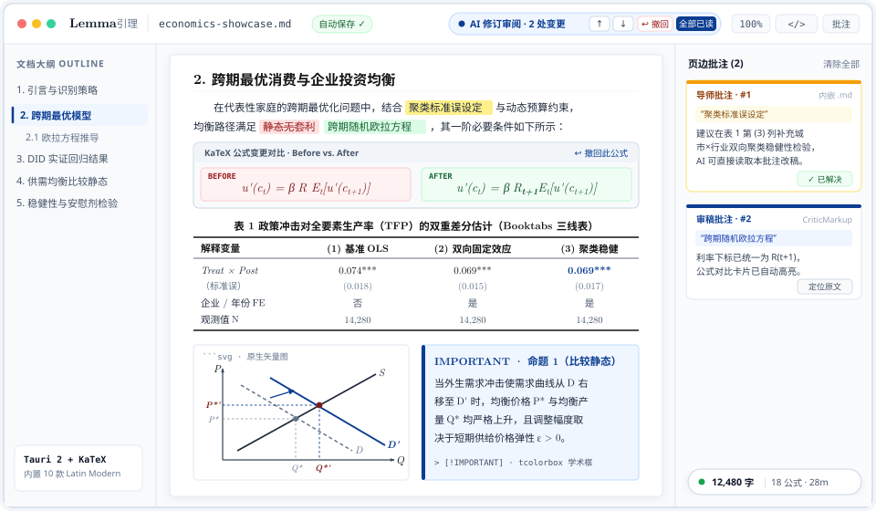

<div align="center">

# Lemma (引理)

**AI-Agent Native, LaTeX-Styled WYSIWYG Markdown Editor & Reader for Academic Writing**

*Built with Tauri 2 + Rust + React + TipTap + KaTeX · ~4 MB Installer · Zero TeX Setup Required*

[](https://github.com/liuqiaodongdong/lemma/releases/latest)
[-FFC131?style=flat-square&logo=tauri&logoColor=000)](https://v2.tauri.app/)
[](https://www.typescriptlang.org/)
[](./LICENSE)

**English** | [简体中文](./README_CN.md) | [中文详细使用说明](./使用说明.md)

<br />



</div>

---

## Download (Windows)

Grab the latest pre-built Windows binaries directly from **[GitHub Releases](https://github.com/liuqiaodongdong/lemma/releases/latest)** — no TeX distribution, Node.js, or Rust required:

| Package | Size | Highlights |
| :--- | :---: | :--- |
| **`Lemma_0.1.0_x64-setup.exe`** *(Recommended)* | ~4.0 MB | Lightweight NSIS installer; bundles all 10 Latin Modern fonts and auto-registers `.md` / `.markdown` file associations |
| **`Lemma_0.1.0_x64_portable.exe`** | ~13.0 MB | Single-file portable binary — double-click and run anywhere |
| **`Lemma_0.1.0_x64_en-US.msi`** | ~5.2 MB | Standard Windows MSI installer |

---

## Why Lemma?

When writing academic papers, literature reviews, or derivations alongside local AI coding agents (Claude Code, Google Antigravity, Codex, etc.), plain Markdown editors fall short: they lack journal-grade LaTeX typography, break on AI math delimiters, overwrite agent edits, and offer no visual way to review formula/table changes or share Word-style advisor comments inside a single `.md` file.

**Lemma** solves the entire local **Human ↔ AI Agent ↔ Advisor** academic workflow:

### 1. Journal-Grade LaTeX Typography Out of the Box
* Bundles **10 TeX Live `Latin Modern` `.otf` fonts** (`public/fonts/latex/`) with `article + ctexart + booktabs + tcolorbox` styling in both **Light & Dark** themes — zero TeX setup needed.
* Smart 2-character Chinese first-line indentation (automatically skipping math blocks, tables, figures, and callouts).
* Automatic **Booktabs three-line tables** (no vertical rules, crisp column alignment & regression significance stars like `0.069***`) and academic callouts (`> [!IMPORTANT]`, `> [!NOTE]`, `> [!TIP]`, `> [!WARNING]`, `> [!CAUTION]`).
* Responsive auto-scaling paper layout + manual zoom (`Ctrl + Wheel`, `Ctrl + + / - / 0`) and clean `@media print` white-paper PDF export styling.

### 2. Fast KaTeX Math & Native Sanitized SVG Figures
* Click any inline (`$...$`) or multi-line display equation (`$$...$$`, `\begin{aligned}`, matrices) to edit with live KaTeX preview.
* **AI Dialect Normalizer**: automatically converts `\(...\)` and `\[...\]` pasted from ChatGPT / DeepSeek / Claude into clean standard Markdown math.
* **Progressive Hydration & Viewport Math Scheduler**: splits large `100 KB+` / `250+`-formula manuscripts cleanly across AST-equivalent chunks so Frame-1 opens instantaneously.
* **Native ```` ```svg ```` Renderer**: lets AI Agents draw publication-ready supply-demand diagrams, DAGs, and architecture charts directly in Markdown with built-in XSS sanitization and inline code editing.

### 3. Seamless Local AI-Agent Collaboration & Rich AST Diff Review
* **Zero-Conflict Blur/Idle Autosave**: switching windows to prompt your AI Agent flushes edits to disk within milliseconds, backed by a Rust `notify` watcher and SHA-256 `SelfWriteGuard` echo suppression.
* **Hot Reload + Visual Diff Review**: when an external agent edits your `.md` file, Lemma hot-reloads smoothly (preserving scroll position) and surfaces a non-intrusive review bar:
  * Word-level green insertions & red strikethrough deletions (with toggleable clean preview).
  * Side-by-side **Before vs. After rendered KaTeX & SVG comparison cards** and table cell diffing.
  * Next/previous hunk navigation (`↑` / `↓`), accept-all, and **one-click per-hunk revert (`↩`)** — leaving zero temporary diff markers in your `.md` file.

### 4. Word-Style Inline Highlights & Margin Comments (Embedded in `.md`)
* Select any text or equation to apply **4-color highlighter** (`==...==` / `<mark data-color=...>`) or attach **Word-like margin comments** (`Ctrl + Alt + M`).
* Highlights and comments are stored directly inside the `.md` file (`<span data-comment=...>` & CriticMarkup `{==...==}{>>...<<}` compatible), so sending a single `.md` file to an advisor or letting an AI Agent read & address every comment works effortlessly.

### 5. Academic Word Count & Anti-Broken-Image Paste
* **Bottom-right Word Count Pill & Detail Card**: real-time Word/Typora-standard mixed CJK + Latin/numeric word count, live selection count (`Selected 286 / 12,480`), character counts, paragraph & formula counts, and reading time (automatically excluding advisor comments & Markdown syntax).
* **Clipboard Image Paste (`Ctrl + V`)**: saves pasted screenshots into `./assets/` next to the `.md` file using portable relative paths.

---

## Keyboard Shortcuts

| Shortcut | Action |
| :--- | :--- |
| `Ctrl + /` | Toggle WYSIWYG / CodeMirror 6 Markdown source mode |
| `Ctrl + Alt + M` / `Ctrl + Shift + M` | Add margin comment / toggle comment sidebar |
| `Ctrl + Shift + H` | Toggle amber highlight on selection |
| `Ctrl + Shift + L` | Toggle H1–H6 outline sidebar |
| `Ctrl + S` / `Ctrl + O` / `Ctrl + N` | Save / Open / New Markdown document |
| `Ctrl + Wheel` / `Ctrl + + / - / 0` | Zoom in / out / reset responsive paper zoom |
| `Ctrl + V` | Paste clipboard image to `./assets/` (or normalize AI math text) |

---

## Development & Build

### Prerequisites
* **Node.js** `>= 18`
* **Rust** `>= 1.77.2` + [Tauri 2 prerequisites](https://v2.tauri.app/start/prerequisites/)

### Commands

```bash
# Install frontend dependencies
npm install

# Run full unit & integration test suite (Vitest)
npm test

# Launch Tauri desktop dev window
npm run tauri dev

# Build frontend & TypeScript check
npm run build

# Build production desktop installers (NSIS + MSI)
npx tauri build
```

Try opening [`demo/economics-showcase.md`](./demo/economics-showcase.md) inside Lemma to explore intertemporal derivations, Bellman equations, Booktabs DID tables, native SVG equilibrium figures, highlights, and margin comments.

---

## License

* Source code is licensed under the **[MIT License](./LICENSE)** © 2026 Laidh (`liuqiaodongdong`).
* Bundled `Latin Modern` OpenType fonts (`public/fonts/latex/`) are distributed under the **GUST Font License (GFL 1.0)**.
