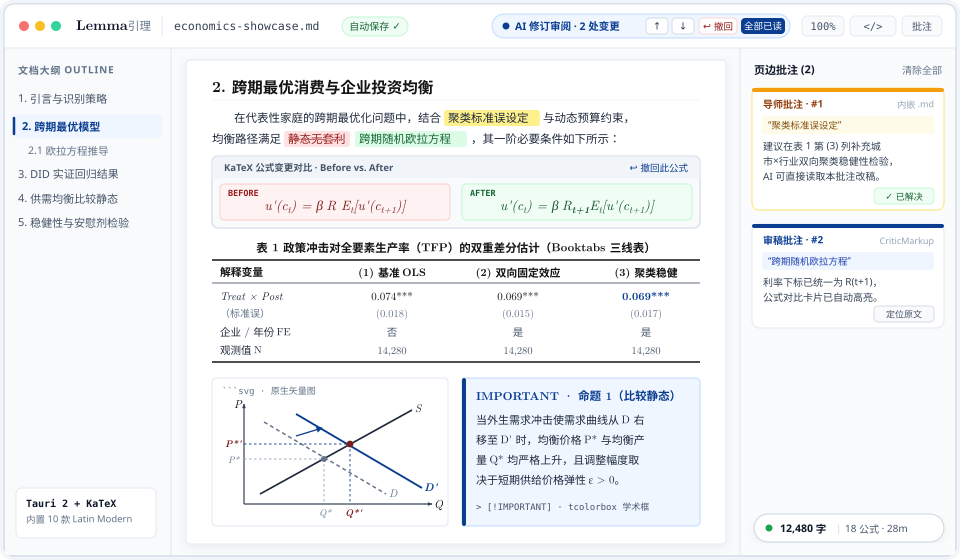

<div align="center">

# Lemma（引理）

**面向学术写作与本地 AI Agent 协同的 LaTeX 风格所见即所得 Markdown 编辑器**

*基于 Tauri 2 + Rust + React + TipTap + KaTeX · 仅 ~4 MB 安装包 · 无需安装 TeX 环境*

[](https://github.com/liuqiaodongdong/lemma/releases/latest)
[-FFC131?style=flat-square&logo=tauri&logoColor=000)](https://v2.tauri.app/)
[](https://www.typescriptlang.org/)
[](./LICENSE)

[English](./README.md) | **简体中文** | [详细使用说明](./使用说明.md)

<br />



</div>

---

## 立即下载（Windows）

前往 **[GitHub Releases](https://github.com/liuqiaodongdong/lemma/releases/latest)** 直接下载编译好的成品，无需配置 TeX、Node.js 或 Rust 环境：

| 安装包 | 体积 | 说明 |
| :--- | :---: | :--- |
| **`Lemma_0.1.0_x64-setup.exe`** *（推荐）* | ~4.0 MB | 轻量 NSIS 安装包，内置全套 10 款 Latin Modern 字体，并自动关联 `.md` / `.markdown` 双击打开 |
| **`Lemma_0.1.0_x64_portable.exe`** | ~13.0 MB | 单文件免安装便携版，拷贝到 U 盘或任意目录双击即用 |
| **`Lemma_0.1.0_x64_en-US.msi`** | ~5.2 MB | 标准 Windows MSI 安装包 |

---

## 核心特性

专为经济学/科研师生与本地 AI Agent（Claude Code、Google Antigravity、Codex 等）日常协同写论文、推导模型、审稿修订而设计：

### 1. 开箱即用的 LaTeX 期刊级排版
* 内置全套 **10 款 TeX Live `Latin Modern` `.otf` 字体**（`public/fonts/latex/`）与 `article + ctexart + booktabs + tcolorbox` **浅色 / 深色双主题**，发给导师和同学无需折腾任何 TeX 环境。
* 智能中文段落首行 2 字符缩进（自动排除公式、图表、表格与提示框）。
* 自动渲染 **Booktabs 学术三线表**（去除竖线、对齐回归系数与 `0.069***` 显著性星号）与 `tcolorbox` 学术定理提示框（`> [!IMPORTANT]`、`> [!NOTE]`、`> [!TIP]`、`> [!WARNING]`、`> [!CAUTION]`）。
* 窗口放大自动等比缩放纸张版面 + `Ctrl + 滚轮` 手动微调缩放 + 干净的白底 `@media print` 导出打印样式。

### 2. 毫秒级 KaTeX 公式与原生 SVG 学术插图
* 点击任意行内公式（`$...$`）或多行公式块（`$$...$$`、`\begin{aligned}`、矩阵）即可弹出实时预览编辑框。
* **自动清洗 AI 公式方言**：粘贴或读取 `\(...\)`、`\[...\]` 定界符时自动转为标准公式渲染。
* **大文档渐进式水合 + 视口公式调度**：针对 `100 KB+`、`250+` 公式的超长论文笔记进行 AST 等价分块加载，首帧秒开不卡顿。
* **原生 ```` ```svg ```` 矢量图渲染**：AI 直接输出矢量供需曲线、因果推断 DAG、博弈树或机制图，内建 XSS 净化并支持随时点击微调 SVG 源码。

### 3. 本地 AI Agent 无缝协同与修订级 Diff 审阅
* **切窗自动秒存防覆盖**：窗口失焦向 AI 发指令时毫秒级落盘，Rust `notify` 监听 + SHA-256 `SelfWriteGuard` 彻底消除自写回环。
* **热更新 + 富文本 Diff 审阅**：AI 后台改完 `.md` 后无感平滑刷新并保持阅读位置，支持：
  * 词句级绿增红删高亮（可一键隐藏删除线预览成稿）；
  * 公式与 SVG 图表 **【修改前 vs 修改后】渲染对比卡**、三线表单元格级变更标示；
  * 上下跳转（`↑` / `↓`）、一键全部已读、以及**单处变更一键撤回（`↩`）**，全程不在 `.md` 中残留任何临时 Diff 污染。

### 4. 类 Word 荧光笔高亮与页边批注（单文件 `.md` 内嵌保存）
* 划词即可弹出 **4 色荧光笔高亮**与 **页边批注栏**（`Ctrl + Alt + M`），兼容 `<span data-comment=...>` 与 CriticMarkup `{==...==}{>>...<<}`。
* 所有高亮与批注直接保存在同一个 `.md` 文件里——微信只发一个 `.md` 给导师批注，收回后直接让 AI Agent 读入批注逐条改稿，改完一键标记「✓ 已解决」。

### 5. 学术字数统计与防裂图粘贴
* **右下角实时字数胶囊与学术明细卡**：对齐 Word / Typora 混排标准（中文字符 + 英文/数字词数），划词即显 `已选 xxx / 全文 xxx 字`，点击展开字符数、段落数、公式数与预计阅读时长（自动排除批注与 Markdown 语法符号）。
* **截图 `Ctrl + V` 防裂图**：自动存至同级 `./assets/` 目录并写入相对路径，打包分享永不丢图。

---

## 常用快捷键

| 快捷键 | 功能 |
| :--- | :--- |
| `Ctrl + /` | 切换 所见即所得 / CodeMirror 6 源码模式 |
| `Ctrl + Alt + M` / `Ctrl + Shift + M` | 添加页边批注 / 开关右侧批注栏 |
| `Ctrl + Shift + H` | 快速添加/取消黄色荧光笔高亮 |
| `Ctrl + Shift + L` | 展开 / 收起左侧大纲（H1–H6） |
| `Ctrl + S` / `Ctrl + O` / `Ctrl + N` | 保存 / 打开 / 新建文稿 |
| `Ctrl + 滚轮` / `Ctrl + + / - / 0` | 缩放纸张 / 恢复自动基准比例 |
| `Ctrl + V` | 粘贴截图到 `./assets/`（或自动标准化 AI 公式） |

更多完整操作指南请查看 [使用说明.md](./使用说明.md)，或直接打开内置示例文稿 [demo/economics-showcase.md](./demo/economics-showcase.md) 体验全部效果。

---

## 本地开发与构建

### 环境要求
* **Node.js** `>= 18`
* **Rust** `>= 1.77.2` 及 [Tauri 2 构建环境](https://v2.tauri.app/start/prerequisites/)

### 常用命令

```bash
# 安装前端依赖
npm install

# 运行全量单元测试与跨模块集成测试
npm test

# 启动桌面端热重载开发窗口
npm run tauri dev

# 类型检查与前端构建
npm run build

# 打包 Windows 正式版安装包（NSIS + MSI）
npx tauri build
```

---

## 开源协议

* 本项目源代码采用 **[MIT License](./LICENSE)** 开源 © 2026 Laidh (`liuqiaodongdong`)。
* 内置的 `Latin Modern` 字体文件（`public/fonts/latex/`）遵循 **GUST Font License (GFL 1.0)** 分发。
